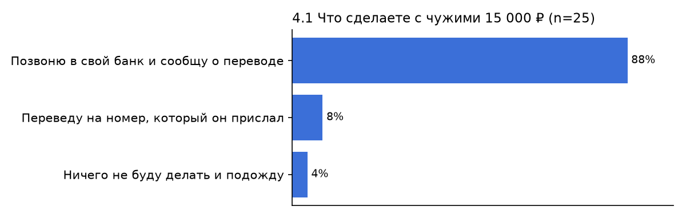
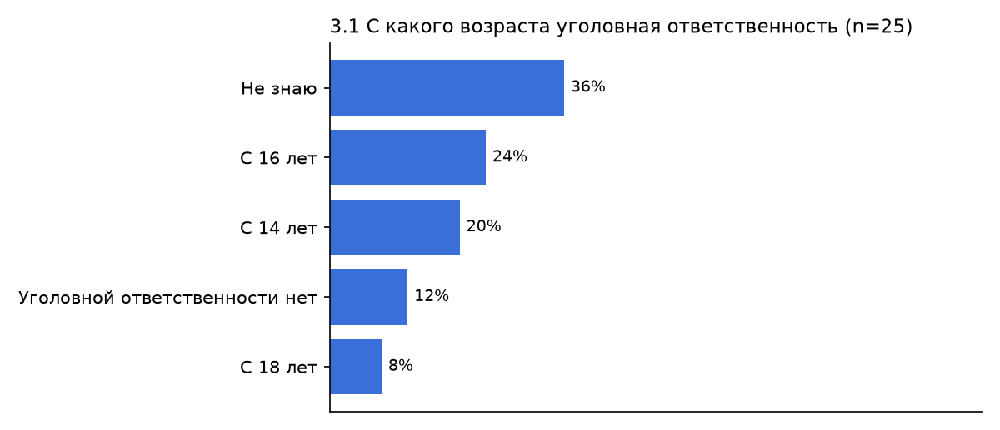
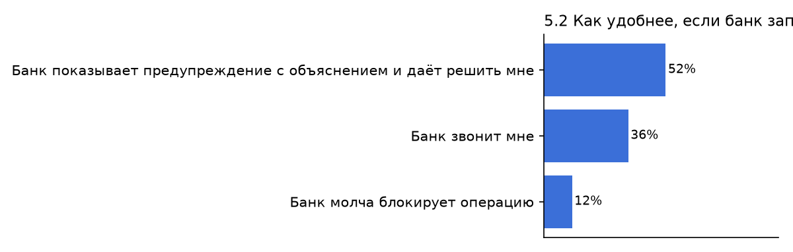
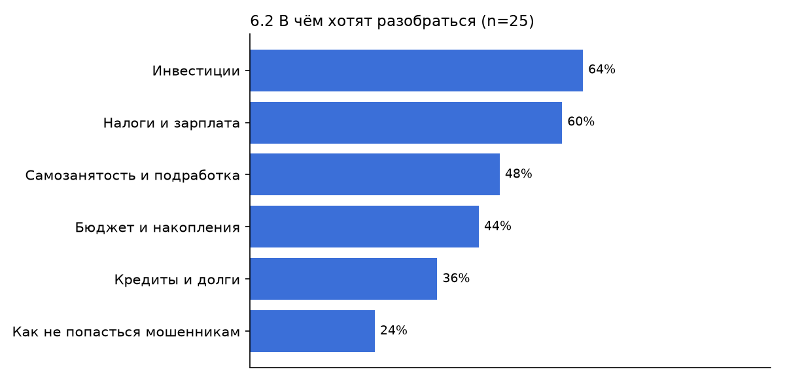

# Результаты опроса по гипотезам (авто-сводка)

- всего анкет: **26**
- в анализе (18–22, подтвердили 18+): **25**
- доля 18–19 лет: **88%** (цель ТЗ — не меньше 30%)

> Сгенерировано скриптом `docs/research/scripts/survey_summary.py`. Выводы и цитаты из интервью дописываем вручную в `survey_results.md`.

## H1. Молодёжь массово получает предложения «подработки» через карту — НЕ ХВАТАЕТ ДАННЫХ (n=25, порог внутри доверительного интервала)

- Получали хотя бы одно предложение: **36%** (9 из 25; 95% ДИ 20%–55%) · порог ≥ 30%
- По возрасту: 18 — 36% (n=11); 19 — 45% (n=11); 20 — 0% (n=1); 21 — 0% (n=1); 22 — 0% (n=1)

| Ответ | Кол-во | Доля |
|---|---|---|
| Ничего из этого не предлагали | 16 | 64% |
| Передать или «продать» свою карту или данные от неё | 7 | 28% |
| Принять перевод на свою карту и переслать деньги дальше | 5 | 20% |
| Оформить карту на себя для другого человека | 5 | 20% |
| Снять наличными деньги, которые пришли от чужих людей | 1 | 4% |

Где предлагали (2.2):

| Ответ | Кол-во | Доля |
|---|---|---|
| Мне такого не предлагали | 16 | 64% |
| Знакомые лично | 4 | 16% |
| Telegram | 4 | 16% |
| На сайтах с вакансиями | 3 | 12% |
| TikTok | 2 | 8% |
| ВКонтакте | 2 | 8% |
| Другое | 2 | 8% |
| В онлайн-играх или Discord | 1 | 4% |

## H2. Большинство не знает, что делать с чужими деньгами — НЕ ПОДТВЕРЖДЕНА (предварительно, n=25)

- Выбрали неверное действие: **12%** (3 из 25; 95% ДИ 4%–30%) · порог ≥ 50%
- Правильный ответ (позвонить в банк): **88%** (22 из 25; 95% ДИ 70%–96%)

| Ответ | Кол-во | Доля |
|---|---|---|
| Позвоню в свой банк и сообщу о переводе | 22 | 88% |
| Переведу на номер, который он прислал | 2 | 8% |
| Ничего не буду делать и подожду | 1 | 4% |

## H3. Большинство не знает реальных последствий — НЕ ХВАТАЕТ ДАННЫХ (n=25, порог внутри доверительного интервала)

- Ответили верно меньше чем на 2 вопроса из 3: **52%** (13 из 25; 95% ДИ 33%–70%) · порог ≥ 50%
- Верно на 3.1 (возраст ответственности 16): **24%** (6 из 25; 95% ДИ 11%–43%)
- Верно на 3.2 (блокировки + база ЦБ): **44%** (11 из 25; 95% ДИ 27%–63%)
- Верно на 3.3 (отвечает владелец): **84%** (21 из 25; 95% ДИ 65%–94%)

Ответы на 3.1:

| Ответ | Кол-во | Доля |
|---|---|---|
| Не знаю | 9 | 36% |
| С 16 лет | 6 | 24% |
| С 14 лет | 5 | 20% |
| Уголовной ответственности нет | 3 | 12% |
| С 18 лет | 2 | 8% |

## H4. Предупреждение с объяснением лучше молчаливой блокировки — НЕ ХВАТАЕТ ДАННЫХ (n=25, порог внутри доверительного интервала)

- Выбрали предупреждение с объяснением: **52%** (13 из 25; 95% ДИ 33%–70%) · порог ≥ 60%
- Понятность экрана перехвата: **4.3 из 5** (n=25) · порог ≥ 4
- Предупреждение остановило бы («да» и «скорее да»): **96%** (24 из 25; 95% ДИ 80%–99%)
- Сталкивались с блокировкой без объяснения: **12%** (3 из 25; 95% ДИ 4%–30%)

| Ответ | Кол-во | Доля |
|---|---|---|
| Банк показывает предупреждение с объяснением и даёт решить мне | 13 | 52% |
| Банк звонит мне | 9 | 36% |
| Банк молча блокирует операцию | 3 | 12% |

## H5. Молодёжь готова учиться финграмотности в банковском приложении — НЕ ХВАТАЕТ ДАННЫХ (n=25, порог внутри доверительного интервала)

- «Да» и «скорее да»: **56%** (14 из 25; 95% ДИ 37%–73%) · порог ≥ 40%

В чём хотят разобраться (6.2):

| Ответ | Кол-во | Доля |
|---|---|---|
| Инвестиции | 16 | 64% |
| Налоги и зарплата | 15 | 60% |
| Самозанятость и подработка | 12 | 48% |
| Бюджет и накопления | 11 | 44% |
| Кредиты и долги | 9 | 36% |
| Как не попасться мошенникам | 6 | 24% |

## Графики

